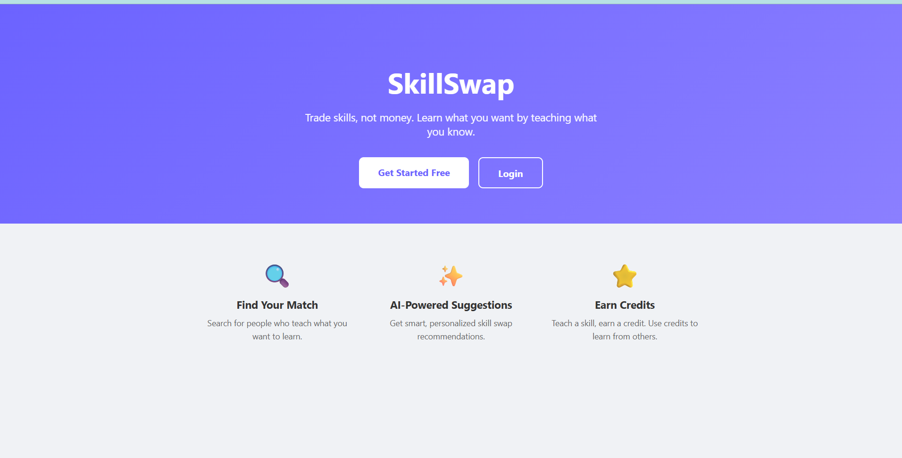
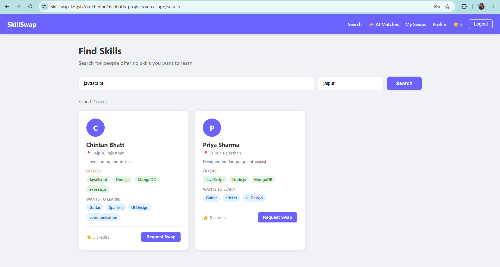
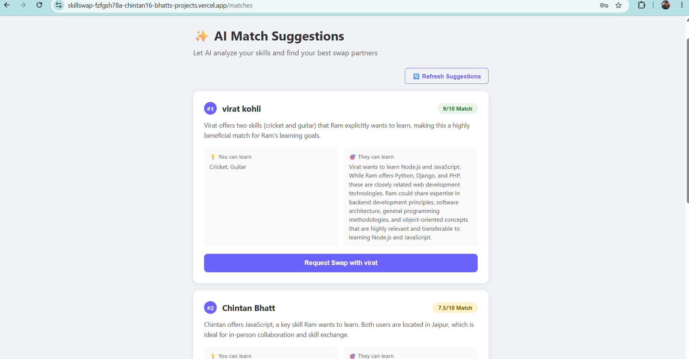
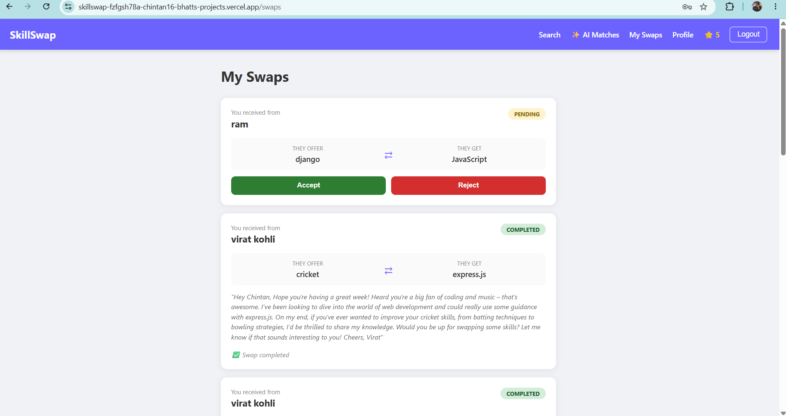

# SkillSwap

A full-stack skill exchange platform where users trade skills instead of money. Teach what you know, learn what you want — powered by AI-driven match suggestions.

**Live Demo:** https://skillswap-app-zeta.vercel.app
**Backend API:** https://skillswap-e206.onrender.com

> Note: Backend is on Render's free tier and may take 30-50 seconds to wake up on first request after inactivity.

---

## Features

- **JWT Authentication** — Secure register/login with bcrypt password hashing and short-lived access tokens
- **Skill Search & Discovery** — Find users by skills offered, filterable by location
- **AI-Powered Matching** — Google Gemini API analyzes user profiles to suggest optimal skill swap partners with compatibility scores and reasoning
- **AI Message Generation** — Auto-generate personalized swap request messages
- **Swap Request System** — Full state machine (pending → accepted/rejected → completed/cancelled) with role-based permissions
- **Credits Economy** — Atomic credit transfers on swap completion using MongoDB's `$inc` operator to prevent race conditions
- **Responsive UI** — Mobile-friendly design with collapsible navigation

---

## Tech Stack

**Frontend:** React, React Router, Axios, Vite
**Backend:** Node.js, Express, MongoDB, Mongoose
**AI:** Google Gemini API (gemini-2.5-flash)
**Auth:** JWT, bcrypt
**Deployment:** Vercel (frontend), Render (backend), MongoDB Atlas (database)

---

## Architecture

```
React (Vercel) → Express API (Render) → MongoDB Atlas
                        ↓
                  Gemini AI API
```

The frontend never calls Gemini directly — all AI requests are proxied through the backend to keep the API key secure server-side.

---

## Key Technical Decisions

- **Atomic credit transfers**: Used MongoDB's `$inc` operator instead of read-modify-write to prevent race conditions during concurrent swap completions.
- **State machine for swaps**: Enforced valid status transitions (`pending → accepted → completed`) at the controller level with role-based checks (only receiver can accept/reject, only sender can cancel).
- **RAG-style AI prompting**: Match suggestions retrieve real user data from MongoDB and inject it into the Gemini prompt, rather than relying on the model's training data.
- **Explicit `select: false` on passwords**: Password field is excluded from all queries by default at the schema level, requiring explicit `.select('+password')` only during login.
- **Environment-based API URLs**: Frontend uses `VITE_API_URL` so the same codebase works against localhost during development and the live Render URL in production, with no code changes.

---

## Project Structure

```
skillswap/
├── server/
│   ├── config/
│   ├── controllers/
│   │   ├── authController.js
│   │   ├── userController.js
│   │   ├── swapController.js
│   │   └── aiController.js
│   ├── middleware/
│   │   └── authMiddleware.js
│   ├── models/
│   │   ├── User.js
│   │   └── Swap.js
│   ├── routes/
│   │   ├── authRoutes.js
│   │   ├── userRoutes.js
│   │   ├── swapRoutes.js
│   │   └── aiRoutes.js
│   └── index.js
├── client/
│   ├── src/
│   │   ├── api/
│   │   │   └── axios.js
│   │   ├── components/
│   │   │   ├── Navbar.jsx
│   │   │   └── ProtectedRoute.jsx
│   │   ├── context/
│   │   │   └── AuthContext.jsx
│   │   ├── pages/
│   │   │   ├── auth/
│   │   │   ├── profile/
│   │   │   ├── search/
│   │   │   ├── swaps/
│   │   │   └── ai/
│   │   └── App.jsx
└── README.md
```

---

## API Endpoints

### Auth

| Method | Endpoint             | Description                              |
| ------ | -------------------- | ---------------------------------------- |
| POST   | `/api/auth/register` | Register a new user                      |
| POST   | `/api/auth/login`    | Login and receive JWT                    |
| GET    | `/api/auth/profile`  | Get logged-in user's profile (protected) |

### Users

| Method | Endpoint                             | Description                                 |
| ------ | ------------------------------------ | ------------------------------------------- |
| GET    | `/api/users/profile`                 | Get own profile (protected)                 |
| PUT    | `/api/users/profile`                 | Update own profile (protected)              |
| GET    | `/api/users/search?skill=&location=` | Search users by skill (protected)           |
| GET    | `/api/users/credits`                 | Get credits balance and history (protected) |
| GET    | `/api/users/:id`                     | Get any user's public profile (protected)   |

### Swaps

| Method | Endpoint                  | Description                                         |
| ------ | ------------------------- | --------------------------------------------------- |
| POST   | `/api/swaps`              | Create a swap request (protected)                   |
| GET    | `/api/swaps`              | Get all swaps for logged-in user (protected)        |
| PUT    | `/api/swaps/:id/accept`   | Accept a pending swap (receiver only)               |
| PUT    | `/api/swaps/:id/reject`   | Reject a pending swap (receiver only)               |
| PUT    | `/api/swaps/:id/cancel`   | Cancel a pending swap (sender only)                 |
| PUT    | `/api/swaps/:id/complete` | Complete an accepted swap, triggers credit transfer |

### AI

| Method | Endpoint                    | Description                                              |
| ------ | --------------------------- | -------------------------------------------------------- |
| POST   | `/api/ai/match-suggestions` | Get AI-ranked skill swap matches (protected)             |
| POST   | `/api/ai/swap-message`      | Generate a personalized swap request message (protected) |

---

## Running Locally

### Prerequisites

- Node.js v18+
- MongoDB Atlas account (or local MongoDB)
- Google Gemini API key from [aistudio.google.com](https://aistudio.google.com)

### Backend Setup

```bash
cd server
npm install
```

Create `server/.env`:

```
PORT=5000
MONGO_URI=your_mongodb_connection_string
JWT_SECRET=your_jwt_secret
GEMINI_API_KEY=your_gemini_api_key
```

```bash
npm run dev
```

### Frontend Setup

```bash
cd client
npm install
```

Create `client/.env`:

```
VITE_API_URL=http://localhost:5000/api
```

```bash
npm run dev
```

Visit `http://localhost:5173`

---

## Screenshots

markdown






---

## What I'd Improve With More Time

- Refresh tokens for longer sessions (currently 15-minute access tokens)
- Real-time notifications via WebSockets for swap status changes
- Image upload for profile pictures (Cloudinary integration)
- Pagination on search results
- Rate limiting on AI endpoints to manage Gemini quota more gracefully
- Unit and integration tests (Jest, Supertest)

---

## Author

Built by Chintan Bhatt
